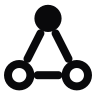
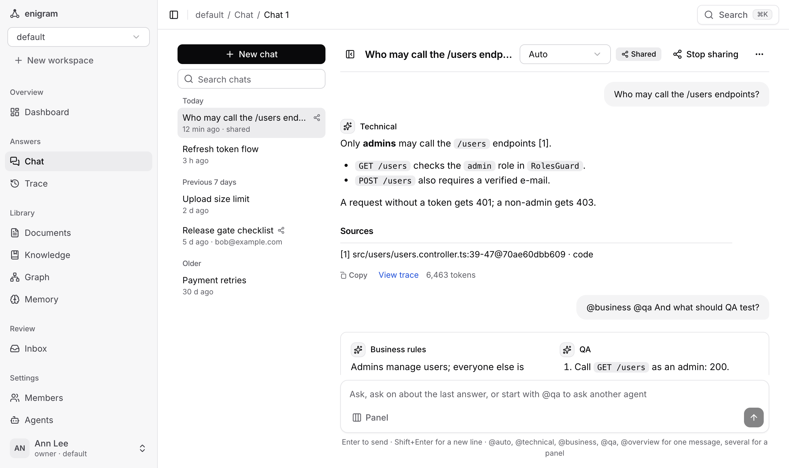
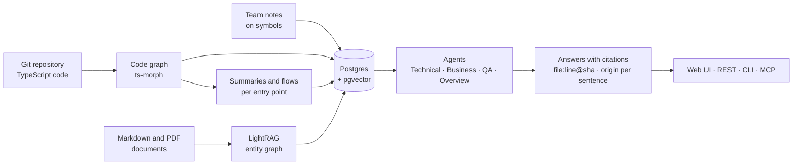

<p align="center">
  <picture>
    <source media="(prefers-color-scheme: dark)" srcset="docs/assets/logo-dark.svg">
    
  </picture>
</p>

<h1 align="center">Enigram</h1>

<p align="center">
  <strong>Ask your codebase and its docs. Get answers pinned to the commit, with your team's notes on top.</strong>
</p>

<p align="center">
  
  <a href="https://github.com/ranggaaprilio/enigram/actions/workflows/ci.yml"></a>
  <a href="LICENSE"></a>
  
  
</p>

<p align="center">
  <a href="#quickstart-docker">Quickstart</a> ·
  <a href="#how-it-works">How it works</a> ·
  <a href="#where-your-data-goes">Your data</a> ·
  <a href="#documentation">Documentation</a> ·
  <a href="CONTRIBUTING.md">Contributing</a>
</p>

<p align="center">
  <picture>
    <source media="(prefers-color-scheme: dark)" srcset="docs/assets/screenshot-chat-dark.png">
    
  </picture>
</p>

> [!WARNING]
> **Enigram is alpha software.** Expect breaking changes to the API, the CLI, the MCP tools and
> the database schema between versions, and rough edges in the UI. Do not rely on it for anything
> critical yet, and back up your Postgres before upgrading.

Enigram indexes a TypeScript repository (a code graph built with ts-morph, plus a summary and a
step-by-step flow per entry point) and its Markdown and PDF documents, and answers questions with
citations pinned to the indexed commit (`file:line@sha`). People can attach notes to symbols:
notes take precedence over code and documents in every answer, are flagged when the code under
them changes, and every sentence of an answer shows where it came from (`[code]`, `[summary]`,
`[human]`, `[document]`). It is used from a web UI, REST, the CLI and MCP (Claude Code). Models are
online: DeepSeek (chat) and Voyage (embeddings); documents go through
[LightRAG](https://github.com/HKUDS/LightRAG) (GraphRAG).

## Why Enigram

DeepWiki, Sourcegraph, Greptile, Swimm and Copilot already explain code with citations, and several
offer MCP access. What Enigram combines:

- Human notes take precedence inside answers, and each sentence carries an origin badge.
- Code citations are pinned to a commit, so they stay checkable after the code moves on.
- Notes go stale on their own: `needs_verification` when the symbol's body *or* a callee changes,
  `orphaned` (with relink candidates) when the symbol disappears.
- Docs-vs-code conflict detection lists document passages that contradict the code.
- Open source (AGPL-3.0-only) and self-hosted: the index, notes and clones stay in your Postgres.

Accuracy against a coding agent with repository access is being evaluated (`docs/evaluation.md`);
there is no verdict yet.

## How it works



Notes beat code and documents in every answer. When the code under a note changes, the note is
flagged for review; when the symbol is gone, it is orphaned with relink candidates.

## Quickstart (Docker)

Prerequisites: Docker, a [DeepSeek](https://platform.deepseek.com) API key and a
[Voyage AI](https://www.voyageai.com) API key.

```bash
git clone https://github.com/ranggaaprilio/enigram && cd enigram
cp .env.example .env    # fill in DEEPSEEK_API_KEY and VOYAGE_API_KEY
docker compose up -d --build
```

Open http://localhost:3000, go to Documents, add
`https://github.com/brocoders/nestjs-boilerplate` and wait until its job is `done`. Then ask a
code question, e.g. "Can an unconfirmed user log in?". The same with curl:

```bash
curl -H 'content-type: application/json' \
  -d '{"url": "https://github.com/brocoders/nestjs-boilerplate"}' localhost:8080/repos
curl localhost:8080/jobs/<id>   # job.id from the response above; until "status": "done"
curl --max-time 180 -H 'content-type: application/json' \
  -d '{"question": "Can an unconfirmed user log in?", "scope": "code"}' localhost:8080/query
```

- Indexing a repository spends DeepSeek tokens on summaries, capped per job by
  `MAX_TOKENS_PER_JOB` (see [Token caps](docs/deployment.md#token-caps)).
- The API and Postgres listen on 127.0.0.1 only. With no `ENIGRAM_API_KEYS` every route is open,
  so set keys (see [API keys](docs/deployment.md#api-keys)) before `API_BIND=0.0.0.0`.
- An existing `pgdata` volume keeps the password it was created with; keep that password in
  `.env`.

## Where your data goes

There is no local-model mode. Do not index code you are not allowed to send to these providers.

| Destination | When | What is sent |
|---|---|---|
| DeepSeek | always | Document chunks (entity extraction), code bodies (summaries and flows), questions, retrieved context, note texts, judge prompts |
| Voyage AI | always | Document chunks, memories, code summaries and symbols (embeddings) |
| TypeSafe Jev | only with `DECISION_PROVIDER=jev` and `TYPESAFE_API_KEY` | The question, evidence, code bodies, claims and note texts (see [Decision layer](docs/notes-and-decisions.md#decision-layer)) |
| Git hosts in `REPO_HOSTS` | `POST /repos`, re-syncs, polling | `git` clone, fetch and `ls-remote` requests |
| Hugging Face | the first PDF | Download of Docling's layout models (nothing is uploaded) |

Postgres, `data/` (uploads, parsed chunks, reports) and the repository clones stay on your
machine. Secret-named files are skipped and secret-looking values are redacted before any
provider call.

## Documentation

| Topic | Where |
|---|---|
| Run without Docker, index storage, reset | [`docs/setup.md`](docs/setup.md) |
| Command line: index books, quality report, ask | [`docs/cli.md`](docs/cli.md) |
| Index a Git repository, re-index on every commit, private repositories | [`docs/repositories.md`](docs/repositories.md) |
| Run as a service: HTTP API, token caps, API keys, roles, sign-in | [`docs/deployment.md`](docs/deployment.md) |
| The web UI, page by page | [`docs/web-ui.md`](docs/web-ui.md) |
| Use from Claude Code (MCP), agent memory, proposals | [`docs/mcp.md`](docs/mcp.md) |
| Notes, the decision layer, correcting the graph, replacing a document | [`docs/notes-and-decisions.md`](docs/notes-and-decisions.md) |
| Roles and rights in detail | [`docs/rbac.md`](docs/rbac.md) |
| Golden set and evaluation runs | [`docs/golden-set.md`](docs/golden-set.md), [`docs/evaluation.md`](docs/evaluation.md) |
| UI design reference | [`docs/design.md`](docs/design.md) |

## Development

The backend is in `apps/api/`, the UI in `apps/web/`; run commands from the repository root (see
CONTRIBUTING.md for the layout, `make` for shortcuts, and [`docs/setup.md`](docs/setup.md) for a
setup without Docker).

```bash
uv run ruff check . && uv run ruff format --check .
uv run pytest -m "not live and not docling"   # fast unit tests
uv run pytest                                  # + Docling, + live APIs when both keys are set
```

## Contributing

See [`CONTRIBUTING.md`](CONTRIBUTING.md). Every contributor signs the CLA ([`CLA.md`](CLA.md)); the
CLA bot asks on your first pull request. CI (lint, tests, image builds) must pass before a merge.

## License

Copyright (c) 2026 Rangga Aprilio Utama and contributors.

Enigram is licensed under the GNU Affero General Public License v3.0 only ([`LICENSE`](LICENSE)).
If you run a modified version as a network service, AGPL section 13 requires offering its source
to its users. Contributions require the CLA ([`CLA.md`](CLA.md)). "Enigram" and its logo are not
covered by the license: see [`TRADEMARK.md`](TRADEMARK.md). Third-party licenses:
[`docs/third-party-licenses.md`](docs/third-party-licenses.md).
