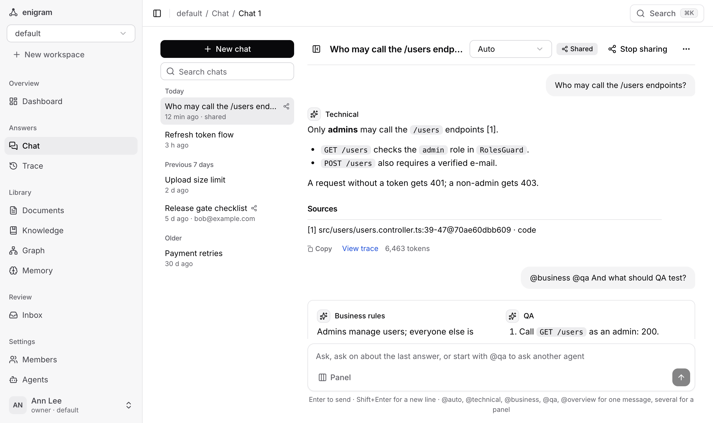
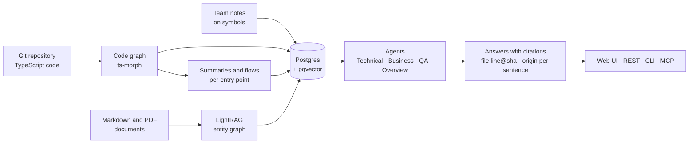

# What is Enigram?

Enigram answers questions about a codebase and its documents, with citations pinned to the
indexed commit (`file:line@sha`) and your team's notes on top.

It indexes a TypeScript repository into a code graph (built with ts-morph) with a summary and a
step-by-step flow for every entry point, plus your Markdown and PDF documents through
[LightRAG](https://github.com/HKUDS/LightRAG) (GraphRAG). People attach notes to symbols. In
every answer:

- **Notes win.** A verified team note outranks code summaries and documents.
- **Every sentence shows its origin**: `[code]`, `[summary]`, `[human]`, `[document]`, or
  `[unsupported]` when nothing backs it.
- **Citations stay checkable.** They point at a commit, so they still hold after the code moves on.

You use it from the web UI, the REST API, the CLI, or MCP (Claude Code).

:::warning[Alpha software]

Expect breaking changes to the API, the CLI, the MCP tools and the database schema between
versions, and rough edges in the UI. Do not rely on it for anything critical yet, and back up
your Postgres before upgrading.

:::

## Why Enigram

DeepWiki, Sourcegraph, Greptile, Swimm and Copilot already explain code with citations, and
several offer MCP access. What Enigram combines:

- Human notes take precedence inside answers, and each sentence carries an origin badge.
- Code citations are pinned to a commit.
- Notes go stale on their own: `needs_verification` when the symbol's body *or* a callee
  changes, `orphaned` (with relink candidates) when the symbol disappears.
- Docs-vs-code conflict detection lists document passages that contradict the code.
- Open source (AGPL-3.0-only) and self-hosted: the index, notes and clones stay in your Postgres.

Accuracy against a coding agent with repository access is being evaluated (see
[How evaluation works](evaluation/how-it-works.md)); there is no verdict yet.

## Supported today

| | Supported | Not yet |
|---|---|---|
| Code | TypeScript projects with a `tsconfig.json`. Monorepos too: every project is merged into one graph | Other languages. A repository without a `tsconfig.json` gets its Markdown indexed, not its code |
| Entry points | **NestJS** (routes, `@Cron`, events, jobs, `bootstrap`), **Next.js** App Router (pages, route handlers, middleware, server actions), **Express** (routes with their mount paths) | Other frameworks: flows start from the exported functions nothing in the repository calls, so summaries and flows are coarser |
| Documents | Markdown and PDF | Other formats |
| Models | DeepSeek (chat) and Voyage AI (embeddings) by default; any OpenAI-compatible endpoint (see [Model providers](getting-started/model-providers.md)) | Native Anthropic or Gemini SDKs |
| Size | Up to 2,000 TypeScript files and 50,000 lines per repository | Larger repositories |

Details: [Index a Git repository](guides/repositories.md).

## How it works

1. **Index.** The worker clones the repository, builds the code graph, and writes a summary of
   every symbol an entry point reaches and a flow per entry point. Documents go into the
   LightRAG entity graph. Everything lands in Postgres with pgvector.
2. **Ask.** A router sends the question to the code agent, the documents, or both. The code
   agent starts from the graph and reads only the lines the graph pointed at.
3. **Answer.** Every sentence cites its source and carries its origin. Notes on the symbols and
   entities involved rank above everything else.
4. **Keep it honest.** When the code under a note changes, the note is flagged for review; when
   the symbol is gone, the note is orphaned with relink candidates.

## Where your data goes

Do not index code you are not allowed to send to these providers. To keep it in-house, point the
chat and embedding endpoints at a local server (see [Model providers](getting-started/model-providers.md)).

| Destination | When | What is sent |
|---|---|---|
| DeepSeek, or the `LLM_BASE_URL` endpoint | always | Document chunks (entity extraction), code bodies (summaries and flows), questions, retrieved context, note texts, judge prompts |
| Voyage AI, or the `EMBED_BASE_URL` endpoint | always | Document chunks, memories, code summaries and symbols (embeddings) |
| TypeSafe Jev | only with `DECISION_PROVIDER=jev` and `TYPESAFE_API_KEY` | The question, evidence, code bodies, claims and note texts (see [Decision layer](reference/decision-layer.md)) |
| Git hosts in `REPO_HOSTS` | `POST /repos`, re-syncs, polling | `git` clone, fetch and `ls-remote` requests |
| Hugging Face | the first PDF | Download of Docling's layout models (nothing is uploaded) |

Postgres, `data/` (uploads, parsed chunks, reports) and the repository clones stay on your
machine. Secret-named files are skipped and secret-looking values are redacted before any
provider call.

## Next steps

- [Quickstart](getting-started/quickstart.md): run it with Docker in a few minutes.
- [Web UI tour](guides/web-ui.md): what each page is for.
- [Use from Claude Code](guides/mcp.md): give your coding agent the knowledge base.
